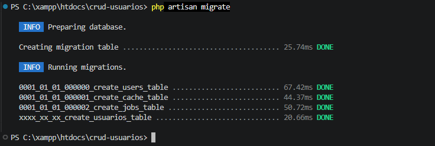
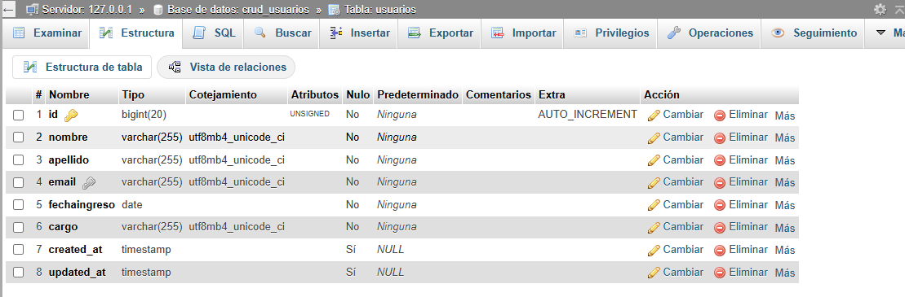
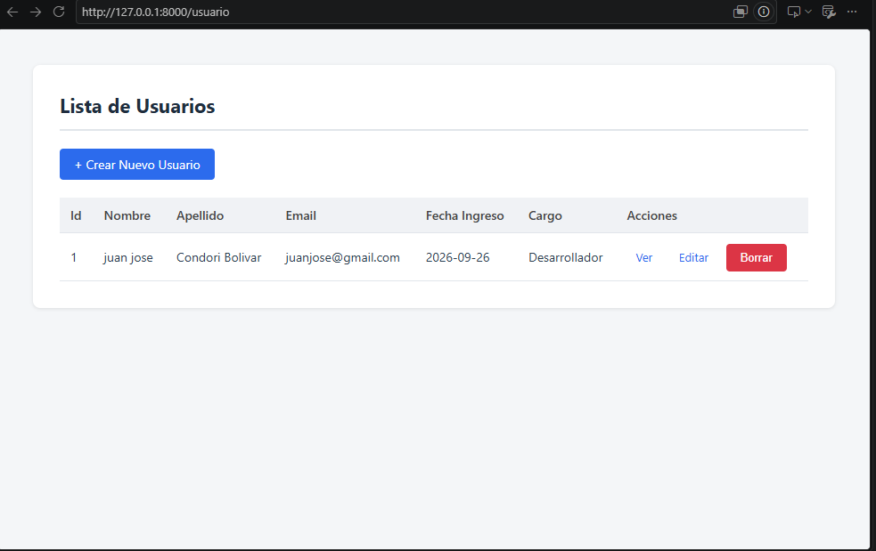
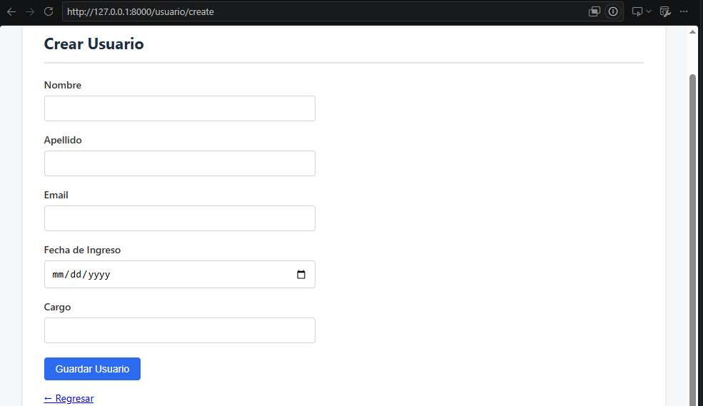
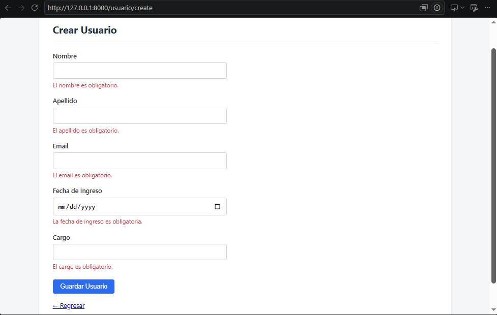
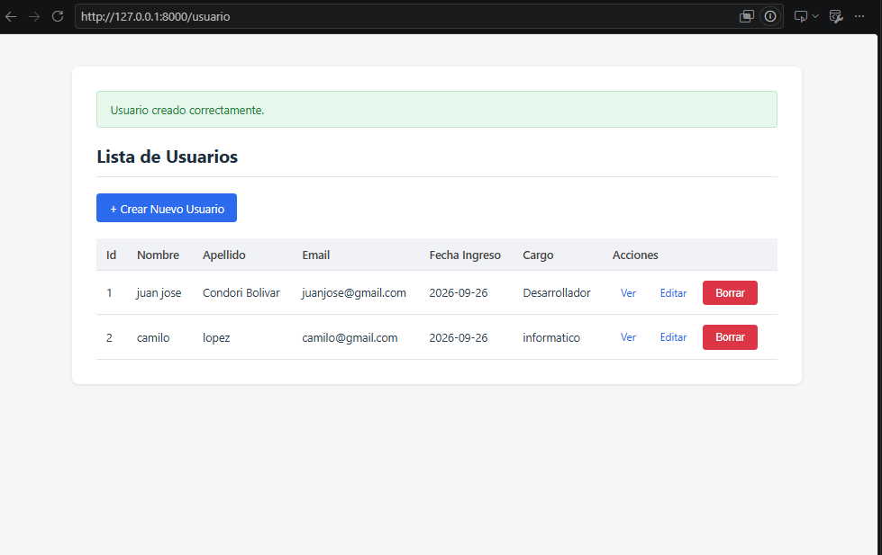
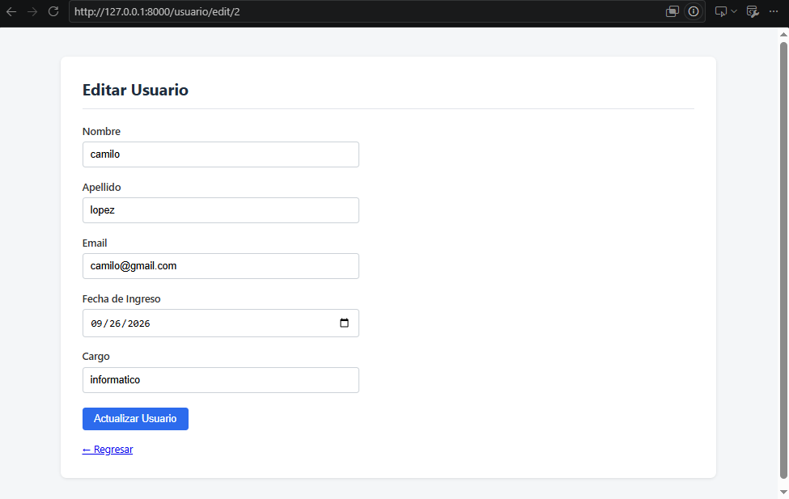
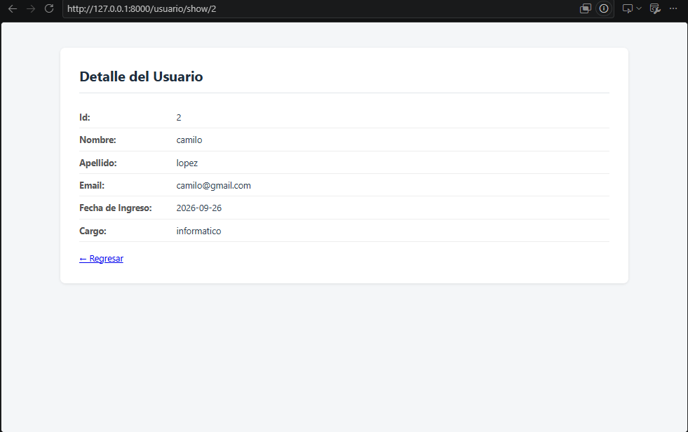
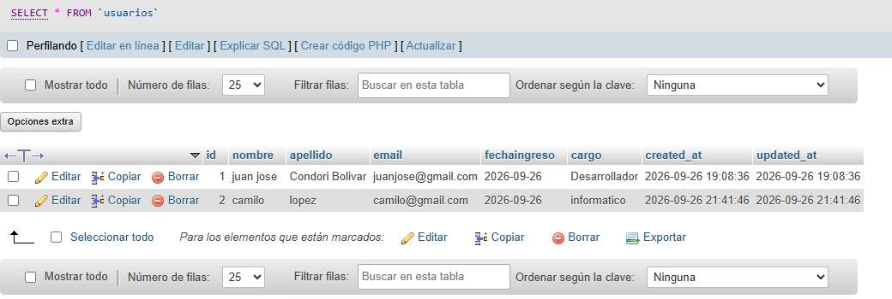
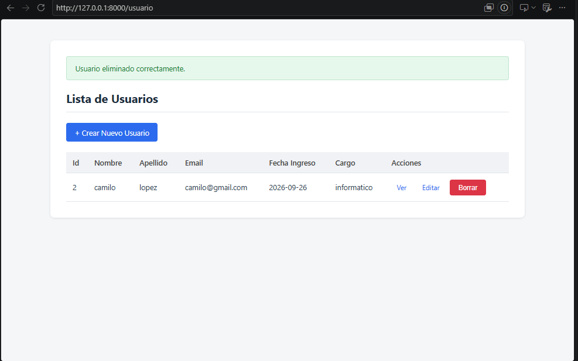

# INSTITUTO DE EDUCACIÓN SUPERIOR TECNOLÓGICO PÚBLICO
## "PEDRO P. DÍAZ"

### LABORATORIO N.° 06
#### Implementación de un CRUD en Laravel — Mantenimiento de Usuarios

| | |
|---|---|
| **Carrera profesional** | Desarrollo de Sistemas de Información |
| **Curso** | Desarrollo Web Integrado |
| **Estudiante** | Juan José Condori Bolívar |
| **Semestre** | IV |
| **Año académico** | 2026 |

---

## 1. Objetivos

- Implementar una aplicación CRUD completa (Crear, Leer, Actualizar, Eliminar) utilizando el patrón MVC en Laravel.
- Aplicar el uso de controladores y vistas para separar la lógica de negocio de la interfaz de usuario.
- Utilizar el ORM Eloquent para interactuar con la base de datos de manera sencilla y coherente.
- Implementar validación de datos personalizada mediante la clase `FormRequest` (CustomRequest).
- Gestionar mensajes de confirmación de operaciones mediante la clase `Session` de Laravel.

---

## 2. Temas tratados

Migraciones y modelos Eloquent, controladores de recursos, definición de rutas RESTful, vistas Blade, validación de formularios mediante Request personalizado, mensajes de sesión para retroalimentación al usuario.

---

## 3. Marco teórico

**CRUD:** acrónimo de Crear, Leer, Actualizar y Eliminar. Hace referencia a las cuatro operaciones básicas que se pueden realizar sobre los datos almacenados en una base de datos.

**FormRequest (CustomRequest):** clase de petición personalizada que encapsula su propia lógica de validación y autorización, separando esta responsabilidad del controlador. Se genera con el comando `php artisan make:request` y contiene los métodos `authorize()` (determina si el usuario puede realizar la petición) y `rules()` (define las reglas de validación de los datos).

**Mensajes de sesión:** Laravel permite pasar datos temporales entre peticiones mediante la sesión, utilizado comúnmente para mostrar mensajes de éxito o error tras una redirección (`redirect()->with('success', 'mensaje')`).

---

## 4. Estructura de la tabla `usuarios`

| Campo | Tipo Laravel |
|---|---|
| id | `id()` |
| nombre | `string()` |
| apellido | `string()` |
| email | `string()->unique()` |
| fechaingreso | `date()` |
| cargo | `string()` |

---

## 5. Estructura final del proyecto

```
crud-usuarios/
├── app/
│   ├── Http/
│   │   ├── Controllers/
│   │   │   └── UsuarioController.php
│   │   └── Requests/
│   │       └── UsuarioRequest.php
│   └── Models/
│       └── Usuario.php
├── database/
│   └── migrations/
│       └── xxxx_xx_xx_create_usuarios_table.php
├── public/
│   └── css/
│       └── estilos.css
├── resources/
│   └── views/
│       ├── layouts/
│       │   ├── principal.blade.php
│       │   └── _partials/
│       │       └── mensajes.blade.php
│       └── usuario/
│           ├── index.blade.php
│           ├── create.blade.php
│           ├── edit.blade.php
│           └── show.blade.php
├── routes/
│   └── web.php
├── .env
└── ...
```

---

## 6. Proceso de desarrollo

### 6.1 Creación del proyecto

```bash
composer create-project laravel/laravel crud-usuarios
cd crud-usuarios
code .
```

### 6.2 Creación de la base de datos

Se creó la base de datos **crud_usuarios** mediante phpMyAdmin (http://localhost/phpmyadmin), con Apache y MySQL iniciados desde el panel de control de XAMPP.

### 6.3 Configuración de la conexión en `.env`

Se configuró la conexión a MySQL:

```
DB_CONNECTION=mysql
DB_HOST=127.0.0.1
DB_PORT=3306
DB_DATABASE=crud_usuarios
DB_USERNAME=root
DB_PASSWORD=
```

```bash
php artisan config:clear
```

### 6.4 Creación del modelo, migración y controlador

```bash
php artisan make:model Usuario -mc
php artisan make:request UsuarioRequest
```

### 6.5 Definición de la migración

```php
public function up(): void
{
    Schema::create('usuarios', function (Blueprint $table) {
        $table->id();
        $table->string('nombre');
        $table->string('apellido');
        $table->string('email')->unique();
        $table->date('fechaingreso');
        $table->string('cargo');
        $table->timestamps();
    });
}
```

```bash
php artisan migrate
```

### 6.6 Definición del modelo

```php
class Usuario extends Model
{
    protected $table = 'usuarios';

    protected $fillable = [
        'nombre',
        'apellido',
        'email',
        'fechaingreso',
        'cargo',
    ];
}
```

### 6.7 Validación mediante CustomRequest

Se creó la clase `UsuarioRequest` extendiendo `FormRequest`, centralizando las reglas de validación para los métodos `store` y `update`:

```php
class UsuarioRequest extends FormRequest
{
    public function authorize(): bool
    {
        return true;
    }

    public function rules(): array
    {
        $usuarioId = $this->route('usuario') ? $this->route('usuario')->id : null;

        return [
            'nombre' => 'required|max:100|min:3',
            'apellido' => 'required|max:100|min:3',
            'email' => [
                'required',
                'email',
                Rule::unique('usuarios', 'email')->ignore($usuarioId),
            ],
            'fechaingreso' => 'required|date',
            'cargo' => 'required|max:100|min:3',
        ];
    }
}
```

La regla `Rule::unique(...)->ignore($usuarioId)` permite que, al editar un usuario, el email no se valide contra su propio registro, evitando un falso error de duplicado.

### 6.8 Definición de rutas

Antes de implementar el controlador, se definieron las 7 rutas del recurso `usuario` en `routes/web.php`, cada una asociada a su método correspondiente y con un nombre de ruta (`->name()`) que luego se utiliza en las vistas para generar los enlaces y las acciones de los formularios:

```php
Route::get('/usuario', [UsuarioController::class,'index'])->name('usuario.index');
Route::get('/usuario/create', [UsuarioController::class,'create'])->name('usuario.create');
Route::post('/usuario/store', [UsuarioController::class,'store'])->name('usuario.store');
Route::get('/usuario/edit/{usuario}', [UsuarioController::class,'edit'])->name('usuario.edit');
Route::put('/usuario/update/{usuario}', [UsuarioController::class,'update'])->name('usuario.update');
Route::get('/usuario/show/{usuario}', [UsuarioController::class,'show'])->name('usuario.show');
Route::delete('/usuario/destroy/{usuario}', [UsuarioController::class,'destroy'])->name('usuario.destroy');
```

Las rutas `edit`, `update` y `show` reciben el parámetro `{usuario}`, que Laravel resuelve automáticamente mediante Route Model Binding, inyectando la instancia del modelo directamente en el método del controlador sin necesidad de buscarla manualmente por ID.

### 6.9 Controlador de recursos

Con las rutas ya definidas, se implementaron los 7 métodos del controlador (`index`, `create`, `store`, `edit`, `update`, `show`, `destroy`), inyectando el `UsuarioRequest` en `store()` y `update()` para delegar en él toda la validación:

```php
public function store(UsuarioRequest $request): RedirectResponse
{
    Usuario::create($request->validated());

    return redirect()->route('usuario.index')->with('success', 'Usuario creado correctamente.');
}
```

### 6.10 Mensajes con la clase Session

Cada operación de escritura (crear, actualizar, eliminar) retorna un mensaje mediante `->with('success', ...)`, encadenado al `redirect()` de cada método del controlador. Este mensaje queda disponible en la sesión durante la siguiente petición, y se muestra en la vista a través de un partial compartido por todas las páginas:

```php
@if (Session::get('success'))
    <div class="alert alert-success">
        {{ Session::get('success') }}
    </div>
@endif
```

### 6.11 Construcción de las vistas

Con el flujo de datos ya funcionando (rutas → controlador → modelo), se crearon las vistas Blade dentro de `resources/views/usuario/`, cada una asociada a un método del controlador:

- **`index.blade.php`**: recorre la colección de usuarios (`@forelse`) y muestra una tabla con las acciones Ver, Editar y Borrar.
- **`create.blade.php`** y **`edit.blade.php`**: contienen el formulario con los 5 campos del modelo, repoblando los valores mediante el helper `old()` en caso de fallar la validación, y mostrando el mensaje de error de cada campo con la directiva `@error`.
- **`show.blade.php`**: presenta el detalle de un único registro.

Todas las vistas extienden un layout común (`layouts/principal.blade.php`), el cual incluye el partial de mensajes de sesión y enlaza la hoja de estilos del proyecto:

```blade
<link rel="stylesheet" href="{{ asset('css/estilos.css') }}">
```

Los estilos se definieron en un archivo CSS independiente (`public/css/estilos.css`), evitando mezclar la presentación con la lógica de las vistas Blade. Este archivo define un contenedor centrado de ancho máximo, una tabla con bordes y colores sobrios, y formularios de ancho reducido, buscando una apariencia limpia y profesional sin que el contenido se desborde.

---

## 7. Funcionamiento de la aplicación

### 7.1 Migraciones ejecutadas correctamente

<!-- INSERTAR CAPTURA: terminal con el resultado de php artisan migrate -->


### 7.2 Tabla `usuarios` creada en phpMyAdmin

<!-- INSERTAR CAPTURA: estructura de la tabla usuarios en phpMyAdmin -->


### 7.3 Listado de usuarios (vista index)

<!-- INSERTAR CAPTURA: vista index con la tabla de usuarios registrados -->


### 7.4 Formulario de creación de usuario

<!-- INSERTAR CAPTURA: vista create con el formulario vacío -->


### 7.5 Validación de campos obligatorios

<!-- INSERTAR CAPTURA: formulario mostrando los mensajes de error de validación -->


### 7.6 Mensaje de confirmación tras crear un usuario

<!-- INSERTAR CAPTURA: vista index mostrando el mensaje de éxito en verde -->


### 7.7 Formulario de edición de usuario

<!-- INSERTAR CAPTURA: vista edit con los datos precargados -->


### 7.8 Detalle de un usuario

<!-- INSERTAR CAPTURA: vista show con la información del registro -->


### 7.9 Registro de usuarios en la base de datos

<!-- INSERTAR CAPTURA: pestaña "Examinar" de phpMyAdmin con los registros guardados -->


### 7.10 Eliminación de un usuario

<!-- INSERTAR CAPTURA: vista index mostrando el mensaje de confirmación tras borrar un usuario -->

---

## 8. Conclusiones

- Separar la lógica de validación en una clase `FormRequest` (CustomRequest) mantiene el controlador más limpio y reutilizable, evitando repetir las mismas reglas en los métodos `store()` y `update()`.
- El uso de `Rule::unique()->ignore()` es indispensable al validar campos únicos (como el email) durante una actualización, para no invalidar el propio registro que se está editando.
- Los mensajes de sesión (`->with('success', ...)`) permiten retroalimentar al usuario sobre el resultado de una operación sin necesidad de JavaScript ni lógica adicional en la vista.
- El uso de Route Model Binding (`{usuario}` en las rutas) simplifica considerablemente los métodos del controlador, al inyectar directamente el modelo resuelto en lugar de buscarlo manualmente por ID.

---

## 9. Repositorio

Código fuente completo disponible en este repositorio de GitHub.
